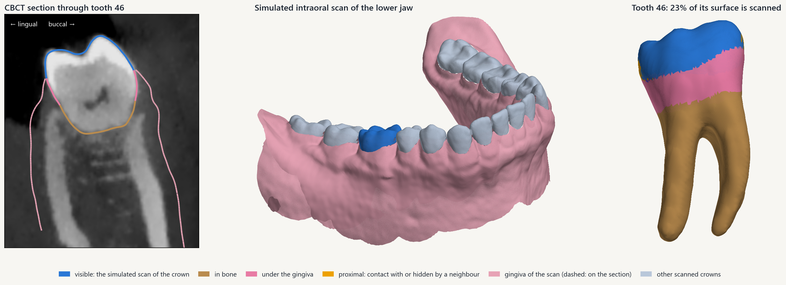
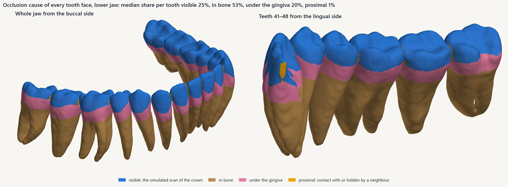
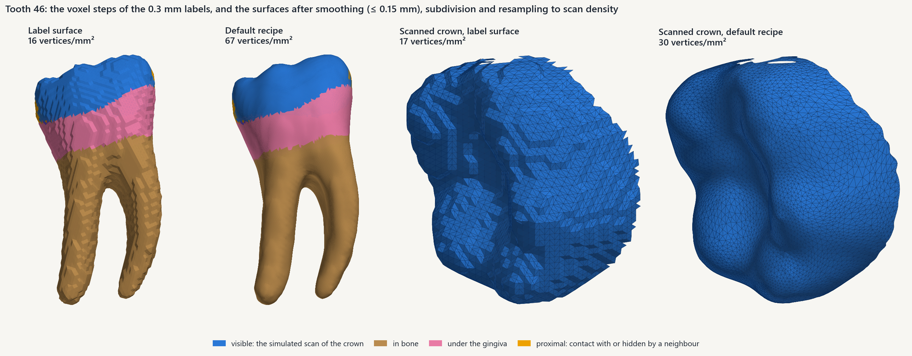
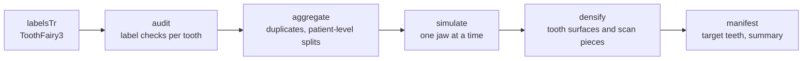

# CBCT2IOS

Simulated intraoral scans (IOS) from the tooth and bone labels of the ToothFairy3 CBCT dataset.

For every jaw, the simulator works out which part of each tooth an intraoral scanner would see: the crown above the
gingiva, as long as it is not hidden by a neighbouring tooth. It writes this visible part as a scan mesh, together with
a gingiva surface. The rest of the tooth is labelled by why it is hidden (bone, gingiva, contact with a neighbour).
Because the scan and the whole tooth come from the same CBCT labels, every simulated scan has an exact ground truth for
the hidden surface. The data can be used to train and test crown-to-root completion, CBCT-IOS fusion or registration
without real paired scans.

Only the label volumes are read. The CBCT intensities are not needed.



*ToothFairy3 case F_009, lower jaw, default recipe. Left: CBCT section through tooth 46, with the tooth surface
coloured by occlusion cause and the simulated gingiva (dashed). Middle: the simulated scan, gingiva and visible crowns,
tooth 46 in blue. Right: the whole tooth 46. The blue part is what the scan contains; the rest is the hidden surface,
coloured by why the scanner cannot see it.*



*The same jaw with every tooth coloured by occlusion cause: the whole jaw from the buccal side, and teeth 41–48 from
the lingual side. Proximal faces (amber) sit where neighbouring teeth touch;
the gingiva covers the 3 mm above the bone crest, more between the teeth.*



*Densification on tooth 46. Left pair: the tooth surface straight from the 0.3 mm labels, then smoothed and subdivided.
Right pair: the scanned crown cut from each, with its mesh edges; the default recipe resamples it to the vertex density
of a real intraoral scan.*

The figures are made by `scripts/make_figures.py` from the output of `simulate` (see the script for the commands).

## Pipeline



1. **Audit** (`cbct2ios/audit.py`). For each tooth, the tooth and pulp labels are merged, filled and reduced to their
   largest 26-connected part. A tooth is excluded as `fragment` (< 2000 voxels), `split_label` (main part < 90 %),
   `fov_truncated` (< 2 voxels from the volume border) or `prosthetic_contact` (within 2 voxels of a crown, bridge or
   implant label). A jaw is simulated when it has a bone label and at least 6 teeth.
2. **Splits.** Cases whose tooth-centroid configurations match within 0.2 mm RMS (rigid fit, mirroring allowed) are
   treated as the same patient. The 70/10/20 train/val/test split is made per group and stratified by subset (F/P/S),
   with a fixed seed.
3. **Simulation** (`cbct2ios/simulate.py`, one jaw at a time):
   - *Tooth surfaces.* Marching cubes of each Gaussian-smoothed tooth mask (σ = 0.5 voxel). The long axis comes from
     PCA, and the crown end is the end with less bone contact.
   - *Bone crest.* For each tooth, 24 angular sectors around the long axis. In each sector, the crest is the
     98th-percentile height of the tooth vertices within 0.45 mm of the bone label. A missing thin buccal or lingual
     plate, which CBCT labels often lose, is replaced by the interproximal crest level.
   - *Gingival margin.* `h_f` = 3.0 mm above the crest on the buccal and lingual sides. Between teeth it rises to the
     papilla, which reaches up to the contact point and at most `h_p` = 4.5 mm. The margin always stays at least
     1.5 mm below the top of the crown.
   - *Soft tissue.* A volume made of free-gingiva collars around each tooth (up to 1.5 mm thick, up to 3 mm into the
     embrasures) and 1.5 mm of mucosa over the alveolar bone, smoothed with σ = 0.3 mm. Its surface within 8 mm of the
     teeth is the scanned gingiva.
   - *Visibility.* A ray-casting scene holds every tooth of the jaw, crowns and bridges, and the gingiva; the opposing
     jaw is left out. A supragingival face is visible when, for at least one of 27 scanner directions, all 9 rays of a
     5° cone are free within 20 mm. The 27 directions are occlusal, tilted, buccal, lingual and slightly apical views.
     Faces seen at more than 70° from their normal do not count, and faces closer than 0.4 mm to a neighbour count as
     contact. Visible patches smaller than 1 mm² are dropped.
   - *Occlusion causes.* Every face of every tooth gets one cause: `visible`, `bone`, `gingiva`, `proximal` (contact
     with a neighbour, or the first thing hit is another tooth) or `other`.
4. **Densification** (default on). The tooth surfaces are smoothed with every vertex held within 0.15 mm of the label
   surface, then Loop-subdivided once; the per-face causes carry over to the four child faces. The scan pieces (crowns,
   prosthetics, gingiva) are smoothed in the same way and resampled to 30 vertices/mm², the vertex density of real
   intraoral scans. Without this step the surfaces keep the 0.3 mm voxel steps of the labels.
5. **Target selection** (`manifest`). Besides the audit exclusions, a tooth is excluded as `unerupted` (crown top
   < 4.5 mm above the median crest), `small_crown` (< 15 mm² visible), `tilted` (> 45° from the jaw axis) or
   `sparse_jaw_scene` (fewer than 6 simulated teeth in the jaw, typically when the bone is outside the field of view).
   A jaw with a crown, bridge or implant is graded `M` (metal), otherwise `A`.

### Parameters

All simulation parameters are in `PARAMS` in `cbct2ios/simulate.py` and can be overridden with
`--params '{"h_f": 2.5}'`.

| Name | Default | Meaning |
|---|---|---|
| `h_f` | 3.0 mm | buccal/lingual gingival margin above the bone crest |
| `h_p` | 4.5 mm | maximum papilla height above the interdental crest |
| `g_min` | 0.4 mm | supragingival faces closer than this to a neighbour are `proximal` |
| `alpha` | 5° | half angle of the viewing cone |
| `incidence` | 70° | maximum angle between the face normal and the viewing direction |
| `reach` | 20 mm | occluders farther along a ray are ignored |
| `contact` | 0.45 mm | tooth surface this close to the bone label is in bone contact |
| `mucosa` | 1.5 mm | soft tissue over the alveolar bone |
| `collar` | 1.5 mm | maximum free-gingiva thickness, buccal and lingual |
| `embrasure` | 3.0 mm | maximum soft-tissue reach between teeth |
| `band` | 8.0 mm | scanned gingiva within this distance of the teeth |
| `smooth` | 0.3 mm | Gaussian smoothing of the soft-tissue volume |
| `island` | 1.0 mm² | smaller visible patches are dropped |
| `papilla_gap` | 1.5 mm | no papilla when neighbours are farther apart |
| `min_exposed` | 1.5 mm | the margin stays at least this far below the crown top |

`h_f` = 3.0 mm is the usual clinical value for a healthy crest (facial margin about 3 mm, papilla 3–4.5 mm). In our
calibration against real IOS crowns registered to CBCT, it was also the value in 1.5–3.0 mm that came closest to the
real visible fractions. `cbct2ios/calibrate.py` repeats that comparison with your own real-pair statistics.

## Installation

Python ≥ 3.9. `matplotlib` is needed only for `scripts/make_figures.py`.

```bash
pip install -r requirements.txt
```

## Data

ToothFairy3 is not included. Download it from the ToothFairy3 challenge
([toothfairy3.grand-challenge.org](https://toothfairy3.grand-challenge.org/)) under its own licence. The code expects:

```
ToothFairy3/
  labelsTr/ToothFairy3F_001.nii.gz, ToothFairy3P_147.nii.gz, ToothFairy3S_0000.nii.gz, ...
```

The labels used are the FDI teeth 11–48, their pulps 111–148, the jaw bones (1 lower, 2 upper), bridges (8),
crowns (9) and implants (10).

## Usage

One case, without an audit folder (the case is audited on the fly; there is no split column):

```bash
python -m cbct2ios simulate --root /data/ToothFairy3 --cases F_009 --output-dir out
```

The whole dataset:

```bash
python -m cbct2ios audit     --root /data/ToothFairy3 --audit audit
python -m cbct2ios aggregate --audit audit
python -m cbct2ios simulate  --root /data/ToothFairy3 --audit audit --output-dir out
```

To run in parallel, start several processes with `--shard-index k --shards n` (for `audit` and `simulate`), add
`--resume` to skip finished cases, and then run `python -m cbct2ios manifest --output-dir out`. Set
`CBCT2IOS_WORKERS` to change the number of threads used for nearest-neighbour queries (default 4).

Options of `simulate`:

| Option | Effect |
|---|---|
| `--cases F_009 ...` | only these cases |
| `--splits train val` | only these splits (with `--audit`) |
| `--params '{...}'` | override simulation parameters |
| `--stats-only` | simulate and record statistics, write no meshes (used for calibration) |
| `--no-smooth-teeth` | tooth surfaces as marching cubes of the 0.3 mm labels |
| `--no-densify-ios` | scan pieces cut from the tooth surfaces as they are, without resampling |

## Output

```
out/
  cases/<case>/<jaw>/
    scan.ply                 the simulated scan: gingiva + visible crowns + visible prosthetic parts
    gingiva.ply
    crowns/<fdi>.ply         visible crown of each tooth (open surface)
    prosthetics/<kind>_<k>.ply
    teeth/<fdi>.ply          whole tooth surface (ground truth), faces coloured by occlusion cause
    faces.npz                per tooth: <fdi>_visible (bool per face), <fdi>_cause (uint8 per face)
    jaw.json                 jaw axis, arch centre, parameters, recipe, mesh sizes
  case_manifests/<case>.csv  one row per tooth: areas per cause, visible fraction, crest and papilla, exclusion
  case_status/<case>.json    per-jaw status and timings
  all_teeth.csv              every simulated tooth
  manifest.csv               target teeth (no exclusion)
  summary.json
```

- Coordinates are world millimetres of the label volume (its NIfTI affine). Scan, crowns and teeth are therefore in the
  same frame as the CBCT.
- `scan.ply` puts the pieces together without stitching them, like the separate patches of a raw scan.
- The faces of `teeth/<fdi>.ply` are in the same order as the arrays in `faces.npz`. The hidden part of a tooth is
  `faces[~visible]`.
- Cause codes and colours in `teeth/<fdi>.ply`:

| Code | Cause | Colour |
|---|---|---|
| 0 | visible (scanned crown) | blue `#2A78D6` |
| 1 | in bone | brown `#B98B4E` |
| 2 | under the gingiva | pink `#E87BA4` |
| 3 | proximal (contact with a neighbour, or hidden behind it) | amber `#EDA100` |
| 4 | other hidden supragingival face | violet `#6250D6` |

## Numbers on ToothFairy3

These are from a run of this pipeline on all 532 label volumes with the default recipe:

- 8,955 teeth simulated; 5,794 target teeth in 477 cases (4,269 graded `A`, 1,525 graded `M`).
- Split of the target teeth: 4,088 train, 496 val, 1,210 test.
- Median visible fraction of a target tooth: 0.29 of its surface.
- Exclusions: 2,190 `fov_truncated`, 673 `prosthetic_contact`, 316 `unerupted`, 163 `tilted`, 142 `small_crown`,
  52 `split_label`, 37 `fragment`, 6 `sparse_jaw_scene`, 6 `no_bone_crest`.
- One case (both jaws, default recipe) takes about 100 s on a laptop CPU with 4 threads.

## What the simulation does not model

- The opposing jaw, cheeks and tongue are not in the scene. Visibility is limited only by the teeth, prosthetics and
  gingiva of the same jaw.
- The gingiva comes from a geometric rule (crest + fixed heights), not from a soft-tissue label. Recession, swelling
  and pockets are not modelled.
- There is no scanner noise, no stitching error, no missing data from reflections, and no colour or texture.
- The result depends on the label quality. A missing thin bone plate is imputed, but other label errors pass through.

## Code

| File | Content |
|---|---|
| `cbct2ios/audit.py` | label audit, duplicate detection, splits |
| `cbct2ios/simulate.py` | the simulator (crest, margin, soft tissue, visibility, causes) |
| `cbct2ios/geometry.py` | sampling, constrained smoothing, Loop subdivision, IOS-density resampling |
| `cbct2ios/pipeline.py` | command line, densification, export, target selection |
| `cbct2ios/calibrate.py` | choice of `h_f` against real visible fractions |
| `scripts/make_figures.py` | the figures of this README (needs matplotlib) |
